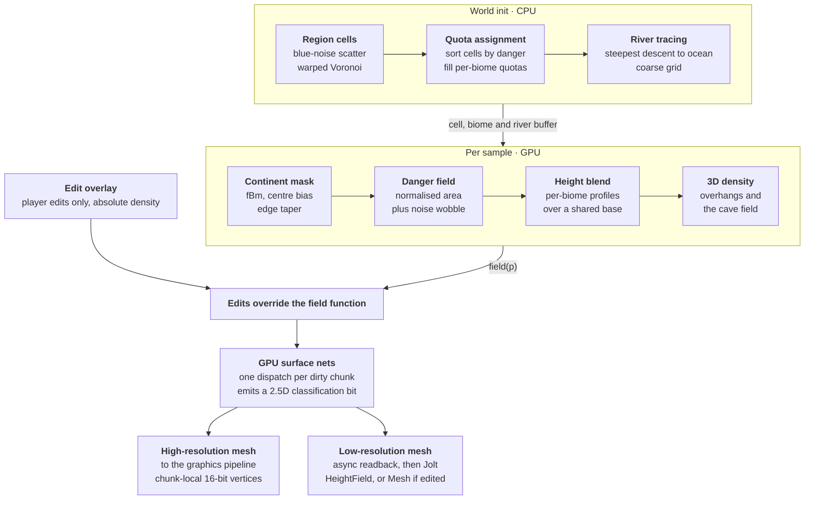

# Voxel World Generation — Design Doc

Draft · last updated 2026-11-10 · this file is canonical

## Summary and key decisions

A single-seed, radially-structured voxel world of 10–20 km radius, generated as a pure function and stored only where the player has changed it. Biome placement is a constrained assignment over Voronoi regions rather than noise thresholding, which is what makes "every biome, every seed, in a known proportion" a guarantee instead of a hope.

| Decision | Choice | Rationale |
| --- | --- | --- |
| Biome placement | Quota-assigned Voronoi regions, ordered by a radial danger field | Presence and area are guaranteed by construction; noise thresholds can't promise either |
| Radial banding | Equal-**area** rings, `r_k = R·√(k/N)` | Disk area grows as r²; linear rings give the inner band a few percent of the world |
| Base terrain storage | None — regenerated on demand from the field function | A 20 km world at 0.5 m is 6.4×10⁹ columns; even the heightmap can't be precomputed |
| SVDAG contents | Player edits only, as a sparse delta over the function | Edits dedup extremely well; noise terrain does not |
| Field function language | Ordinary C++ that also compiles as HLSL behind a vector header ([ADR-001](adr-001-field-function-authority.md), [ADR-002](adr-002-drop-wgsl-native-viewer.md)) | WGSL permits reassociation and FMA fusion with no opt-out (§15.7.5), so it cannot be the determinism authority. C++ can, and HLSL is the same text. WGSL went with the browser prototype that was its only consumer |
| Prototype environment | Native C++ throughout ([ADR-002](adr-002-drop-wgsl-native-viewer.md)) | A browser prototype tunes against a translation of the generator on a backend that may reassociate; a native viewer runs the shipping code |
| Repository | One repo, several build systems | The shader source is shared verbatim by both tracks; a repo boundary through it guarantees drift |
| Physics shapes | `HeightFieldShape` by default, `MeshShape` only for overhangs and edited chunks | Cooking and query cost differ by an order of magnitude, and most chunks are 2.5D |

The two prototype tracks are independent and can run in parallel. Track B (C++ pipeline) should be built against a trivial analytic world — a sine heightfield and a sphere — so that pipeline bugs are never confused with worldgen bugs.

## Goals, constraints and non-goals

The generator must satisfy six hard requirements; everything else in this document is in service of them.

1. **Bounded disc world.** Radius `R` is a parameter, 10 km or 20 km. 10 km is Valheim scale (314 km²); 20 km is 1,257 km², four times that.
2. **The edge tapers.** Land falls away to deep ocean before `r = 1`, and there is a hard terminator past it. No invisible wall.
3. **Every biome appears in every seed.** Not probabilistically — by construction, verified by an automated test over N seeds.
4. **Roughly equal measure per biome.** Each biome's share of land area falls within a stated tolerance of its quota, every seed.
5. **Calm near the centre, hostile at the rim.** Biome placement is ordered by distance from world centre, with enough noise that it never reads as concentric rings.
6. **Volumetric and destructible.** Caves and overhangs exist; the player can dig. This rules out a pure heightmap representation, though most of the world is locally 2.5D and that fact is exploitable.

**Soft goals.** Deterministic from a 64-bit seed on any machine. World generation parameters tunable without a recompile during prototyping. Generation cheap enough to run per-chunk on demand rather than precomputed.

**Non-goals for this document.** The gameplay loop, progression and the concrete biome list — all of which are expected to churn. The generator is therefore written against an abstract biome *contract* (see below) and knows nothing about what a biome means. Networking, persistence format and art direction are also out of scope here.

**Known tension.** Requirements 4 and 5 fight each other if handled naively, because disc area grows as r². This is addressed in the area budget section and is the single most likely thing to be got wrong.

## Generation pipeline overview

The expensive, global reasoning happens once per seed on the CPU and produces a small buffer. Everything after that is a pure function of position, evaluated per sample on the GPU, with the edit overlay as the only state in the system.



The layers are specified individually below. Note where the two phases meet: the CPU half decides *which biome goes where*, the GPU half decides *what the ground looks like there*, and they communicate through one read-only buffer of a few thousand records. That boundary is what keeps the per-sample cost low enough for a world that is never stored.

## Layer specification

Seven layers, each independently tunable and independently testable. Layers 0–2 are evaluated per-sample in the shader; layer 3 is a CPU preprocess at world init; layers 4–6 are per-sample again.

### Layer 0 — continent mask and edge taper

Normalise `r = length(p.xz) / R`, then:

```
base   = fbm(p.xz * f_c) + o
t      = smoothstep(0, 0.40, r)
h_base = lerp(smax(base, F, k), base, t) - B * smoothstep(0.80, 1.0, r)

smax(a, b, k) = 0.5*(a + b + sqrt((a-b)^2 + k)) - 0.5*sqrt(k)
```

The fBm term is 4–6 octaves with a base feature size of 2–8 km. The `smax` term guarantees a home landmass at the centre regardless of seed. The last is the taper. Past `r = 1.0`, subtract a large constant so terrain drops away into void — the Valheim world-edge waterfall, which is the cheapest honest terminator.

**The home-landmass guarantee is a floor, not a lift, and that distinction is the whole of it.** An earlier draft used an additive dome, `A·(1 - smoothstep(0, 0.25, r))` with `A = 0.70`. Against a continent fBm with a standard deviation of 0.224 that is a +3.1σ bias at the origin, so the world's highest point landed within 640 m of the centre on **59 of 64 seeds**, and within `r < 0.25` on all 64. Every seed grew the same mountain in the same place. A floor only raises ground that was already below it, so the peaks stay where the noise put them: peaks inside `r < 0.25` fall to 2/64, and the central disc becomes *more* reliably land (90.6% → 95.6%), because a floor is a more direct statement of the thing actually wanted.

Blend the floor out across `r` rather than letting `F` fall to zero. `smax(base, 0, k)` is a soft ReLU, and using it world-wide clamps every ocean to a uniform shelf — measured interior ocean depth collapses sevenfold.

Relief is therefore layer 4's job, via the per-biome profiles, which is where it is controllable per biome. A mountain *near* spawn belongs in layer 3's adjacency cost, where it lands somewhere different each seed; a layer-0 dome puts it in the same place forever.

Use OpenSimplex2 or simplex-family noise, not classic Perlin. Perlin's axis-aligned gradient artifacts are invisible at 10 m and glaring at 5 km, which is exactly the scale this layer works at.

### Layer 1 — danger field

`D(p) = saturate(r² + w · fbm_low(p.xz))`, where `r²` is normalised **area**, not normalised radius — see the area budget section below, which is the authority on this. **Measured settings: `w = 0.60` with a 2 km feature size**, not the 0.15–0.25 at 3–6 km first guessed here. At `w = 0.20` every seed reads as a dartboard — same silhouette, glacier always on the coast — and no assertion catches it, because Spearman sits at 1.00 throughout. Only the contact sheet shows it. A 2 km feature on its own fragments the assignment into speckle; it reads as zones because the layer-3 repair pass restores patch size independently.

This is the "distance from centre" axis, softened. The wobble buys an occasional hostile pocket within sight of spawn and a calm valley at the rim — the thing that stops a radially-ordered world from reading as a dartboard. `w` is the single most important feel parameter in the generator; expose it prominently in the prototype.

### Layer 2 — region cells

Poisson-disc or blue-noise scatter of `N` points across the disc, giving a Voronoi partition. Boundaries are then domain-warped by 1–2 km of low-frequency noise, so cells read as organic coastlines and treelines rather than straight bisectors.

At runtime this is a buffer of `N` cell records plus a coarse uniform bucket grid (say 64×64 over the world bounds) so a lookup touches a handful of candidates. Cheap enough to evaluate per voxel.

### Layer 3 — quota assignment (CPU, world init)

This is the layer that makes the hard requirements true. It runs once per world, in well under a millisecond, and uploads its result as a small buffer.

```
land_cells  = cells where layer-0 height > sea level
for each biome b:  quota[b] = b.area_fraction * total_land_area

sort land_cells ascending by D(centroid)

for cell in land_cells:
    candidates = biomes where D(cell) within b.danger_band
                        and quota[b] > cell.area / 2
    if candidates empty: candidates = biomes where quota[b] > cell.area / 2  # relax
    pick b minimising  |D(cell) - b.danger_preferred|
                     + adjacency_penalty(b, already-assigned neighbours)
    assign cell -> b;  quota[b] -= cell.area
```

Sorting by danger before assigning is what produces the radial ordering; the quota decrement is what produces equal measure; the relaxation branch is what guarantees presence even on a pathological seed. The adjacency penalty is where rules like "never place the hardest biome adjacent to the spawn cell" live, as a cost rather than a hard constraint, so the solver can never deadlock.

**The half-cell floor on the quota gate is load-bearing.** An earlier draft of this pseudocode gated on `quota[b] > 0`, which lets a biome holding a sliver of quota swallow a whole cell. Every biome then overshoots by up to one cell, and whichever sorts last by danger absorbs the sum of everyone else's overshoot — measured at 200 seeds out of 200 missing the ±10% requirement, with the last biome landing 53% under target on a typical seed. Holding back half a cell makes the rounding symmetric instead of always positive. See [`tools/validate/README.md`](../tools/validate/README.md) for the measurement.

Cells left over in ocean become island clusters, drawn from the same quota pool. A biome occasionally landing island-only is free seed variety at no cost.

> **Not implemented.** `assign.cpp` skips every ocean cell outright (`if (!cells[i].is_land) continue;`, both passes), so no cell is ever placed in water and no biome can land island-only. The per-biome `allow_island` flag below is parsed out of `archetypes.json` and authored on all nine biomes, but nothing reads it. This is the single largest gap between this document and the generator, and it is why the world currently has no island gameplay to speak of: not a design decision, just a layer that only ever learned to paint land.

### Layer 4 — height composition

Each biome supplies a height profile: base elevation, amplitude, octave count, and a warp between ridged and billowy. Final height is a weighted blend of the neighbouring cells' profiles, weighted by smoothed distance to the cell boundary.

**Blend the resulting heights over a shared continental base — do not blend the noise parameters.** Interpolating octave counts and lacunarity produces mush at every boundary, and the boundary is exactly where the player is looking.

**As built.** The four nearest cells are evaluated in full and only their metres are mixed, weighted by `(1 - Δd/blend_width)²` where `Δd` is the gap to the nearest cell — a proxy for distance to the bisector. The continental mask is scaled to metres and the biome relief is faded in across the shoreline so the coast does not step. `ridge_blend` warps plain fBm towards ridged, rather than mixing billowy against ridged: those two are mirror images and cancel to a flat field at the midpoint.

Which cells are near a point is an index question, not a field one, so the lookup and the weights sit in the caller while every metre comes out of the dialect. That split is what lets the harness and the GPU share the arithmetic without sharing a spatial index.

### Layer 5 — rivers

After the heightfield is defined, trace steepest-descent paths from high cells to the ocean on a coarse grid (256² over the world is ample), then carve the result with a distance-to-polyline SDF subtracted from the height.

Noise-faked rivers are cheaper and always read as fake once the player has seen real drainage. The polyline set is small, computed once at world init, and lives in the same buffer as the cells.

**As built.** Steepest descent on a raw heightfield stalls in every local minimum, so the surface is depression-filled with a priority flood first. That buys more than convenience: the flood pops cells in order of spill height, so the cell that relaxes a neighbour is always downstream of it. Taking that as the flow direction makes "descends monotonically and terminates in ocean" true *by construction* rather than a property to test for and patch up — which is why the river sanity check passes on every seed rather than most of them. Upstream area then comes from walking the flood order backwards, and any cell above the accumulation threshold emits one segment.

**Use eight-connected flow, not four.** Four-connected flow can only run along the grid axes, so every river comes out as a right-angled staircase. At 87 m per pixel on a contact sheet that is completely invisible; on a single seed rendered close up it looks like a circuit board. One corner-cutting pass — segments between edge midpoints rather than cell centres — takes the remaining 45° kinks off for free.

The lesson generalises past rivers: **the contact sheet is the wrong instrument for anything thinner than a few hundred metres.** It catches global structure, and it cannot see a channel.

### Layer 6 — 3D density

```c
density(p) = height(p.xz) - p.y
           + biome.overhang_strength * ridged3d(p * f_o)
           - cave_field(p)
```

`cave_field` is a gyroid or worley-based tunnel network, masked by biome and by depth so caves do not open onto cliff faces at random. Surface nets consumes `density` directly; the sign change is the surface.

The critical property for LOD: this function must be *filterable*. Octave count has to fall with voxel size, or distant chunks will disagree with near chunks and pop on LOD transition. See the meshing section.

`cave_field` is the intersection of two ridged 3D fields rather than the gyroid written above: a gyroid is sin and cos, and invariant 9 forbids libm upstream of the golden hash. Two ridged sheets meet in a line, and a line is a tunnel.

### Layer 7 — cave entrances

The depth mask in layer 6 is load-bearing in both directions. It stops caves opening onto cliff faces at random, and in doing so it seals the entire cave system. Measured over 12 seeds: 43% of land columns had air beneath them, 83% of those under 25 m or more of rock, and the shallowest rind anywhere was 1 m — never zero. The handful of near-breaches were not cave mouths either, only places where the layer-6 overhang term happened to drop real rock below the heightfield the mask is measured against.

Loosening the mask is the wrong lever: it opens holes wherever the noise crests near grade, which is swiss cheese rather than entrances. Minecraft hit the same wall and answered it the same way — it *raises* density near the surface to suppress cheese caves and then adds a separate density term whose only job is cave entrances, plus carvers that are explicitly allowed to break through. Access is its own system.

So shafts are traced on the CPU at world init, from a point on the surface downwards, asking layer 6 at every step whether it has broken into air yet:

```
pick a mouth on land, uniform in AREA
walk down, wandering, 4 m per step, tilt 0.3..1.8 lateral metres per metre of drop
  air shallower than entrance_min_depth is an overhang, not a cave — keep going
  first sample with density <= 0 → keep the polyline
  out of steps → discard the candidate
```

Nothing is stored that did not reach a cave, so surface-to-cave connectivity holds **by construction** — the same shape of argument as priority flood making rivers reach the sea, rather than tracing something plausible and asserting afterwards that it worked.

The polyline is stored with a radius at each vertex: a wide bowl at the mouth, a narrow throat below it, chambers at intervals, and a taper into the cave. Evaluation follows layer 5's split — which segments are near a sample is a spatial index question and stays in the caller, the capsule SDF and the carve are in the dialect. The carve deliberately ignores `cave_depth_mask`, because breaching the surface is the whole point of the layer.

Branches are dead ends on purpose. One side passage per trunk, sometimes, kept whether or not it reaches anything: the connectivity guarantee is carried by the trunk, and a passage that goes nowhere is a feature.

## Area budget and the equal-measure problem

Disc area grows as r², so radial bands of equal *width* have wildly unequal *area*. With five linear bands the innermost gets 4% of the world and the outermost 36% — a ninefold difference, and the calm starting biomes are the ones that lose.

The fix is equal-area rings: `r_k = R · √(k / N)`.

| Ring, inner → outer | Linear `r_k/R` | Linear area share | Equal-area `r_k/R` | Equal-area share |
| --- | --- | --- | --- | --- |
| 1 | 0.20 | 4% | 0.447 | 20% |
| 2 | 0.40 | 12% | 0.632 | 20% |
| 3 | 0.60 | 20% | 0.775 | 20% |
| 4 | 0.80 | 28% | 0.894 | 20% |
| 5 | 1.00 | 36% | 1.000 | 20% |

The same applies to the danger field: `D` should be defined on normalised area, not normalised radius, or every quota the assignment layer computes will be fighting the geometry. In practice that means `D ∝ r²` before the noise is added.

**Ocean is a separate budget line.** Quotas are fractions of *land* area, not world area. Mixing them means a seed with more coastline silently shrinks every biome.

That separation is what makes the land fraction a free parameter. It now sits at a **35% mean**, so ocean takes about 65% of the disc rather than the 40–50% first guessed here — and every biome still receives its stated share of whatever land exists, because the quota is a fraction of land. Measured over 200 seeds at 35%: presence passes on every seed and boat connectivity reaches every biome. What degrades at low land fraction is the *accuracy* of the share, not the share itself: fewer land cells means coarser granularity, which is paid for with smaller cells.

### Scale and cell count

Quota accuracy is limited by cell granularity: you cannot assign half a cell. Size the cell count so each biome receives enough cells for the tolerance you want, then recover large contiguous patches with a **contiguity bonus** in the assignment cost — a negative penalty for matching an already-assigned neighbour.

**Measured correction — the contiguity bonus does not work.** Because cells are assigned in global danger order, a cell's already-assigned neighbours are the ones at slightly lower `D` — exactly the ones the `danger_preferred` term would have given the same biome anyway, so the bonus only reinforces a decision already made. Sweeping it from 0.00 to 0.80 changes the output not at all, to four significant figures, with narrow bands or wide. Do not reach for it.

**Patch size is a knob again, through a repair pass.** After assignment, swap biome *labels* between pairs of cells: move a boundary cell into a neighbouring biome, and pay for it by moving some cell of that biome back. Every biome's cell count is unchanged by construction, so presence cannot break, and only the area difference between the two cells drifts — held inside a budget. Reject a swap that leaves a cell outside its new danger band, creates a forbidden border, or exceeds the drift budget; accept when contiguity gained outweighs danger displacement.

Measured over 96 seeds, it roughly triples mean patch area wherever it is applied, and quota accuracy does not move:

| config | no repair | 4 passes | quota err |
| --- | --- | --- | --- |
| `w` 0.20, 4.5 km feature | 4.5 cells / 1.45 km² | 11.5 cells / 3.72 km² | 3.5% |
| `w` 0.60, 2 km feature | 1.9 cells / 0.62 km² | 7.4 cells / 2.40 km² | 3.9% |
| `w` 0.60, 9 km feature | 3.8 cells / 1.24 km² | 11.4 cells / 3.67 km² | 3.6% |

It converges by about four passes and costs well under a second over 200 seeds. The price is paid in radial ordering: Spearman falls from 1.00 to 0.92–0.99, still far above the 0.8 the harness asserts. So patch size and quota granularity are independent knobs after all, as this section originally claimed — just not through the mechanism it named, and `w` remains the control for how strongly the world reads as radial.

**The pass also repairs adjacency.** Because the greedy assignment treats `adjacency_mask` as a cost rather than a veto — deliberately, so it can never deadlock — it can leave forbidden borders behind, and a fast-varying danger field makes that far more likely: at `w = 0.60` with a 2 km feature, 70 seeds in 200 had one. Scoring the removal of a violation as a gain, and refusing any swap that increases the count, takes that to **0 in 200** while the quota, presence and land-fraction checks stay green. Without the repair pass those settings would not be usable.

Rule of thumb: `cells ≈ 15 × biome_count / land_fraction`, then check the implied cell diameter lands between 1 km and 2.5 km. **This undersizes R = 10 km by about 4×.** The estimate assumes the quota error is centred; it is not, so ~245 cells misses the ±10% requirement on every seed even with the half-cell gate. Budget ~920 cells (0.32 km² each) at R = 10 km. R = 20 km passes at the figure below.

| Metric | R = 10 km | R = 20 km |
| --- | --- | --- |
| Disc area | 314 km² | 1,257 km² |
| Land at 55% | 173 km² | 691 km² |
| Per biome at 9 biomes | 19 km² | 77 km² |
| Region cells, total | \~245 | \~960 |
| Mean cell area / width | 1.3 km² / 1.3 km | 1.3 km² / 1.3 km |
| Land cells per biome | \~15 | \~59 |
| Quota granularity | ±7% | ±2% |
| Typical patch, 3–6 cells | 4–8 km² | 4–8 km² |

Holding cell size constant across both radii keeps biome patches the same size on the ground, which is what the player actually experiences; only the count changes. A thousand cells in a bucket-grid lookup is nothing on the GPU.

**On choosing R.** 1,257 km² is a great deal of ground to fill. Unless content density is high or there is fast travel, 20 km will read as empty where 10 km reads as dense. Build at 10, keep `R` a parameter, and decide once there is something to do in the world.

## Biome archetype contract

The generator knows nothing about what a biome *is*. It consumes a table of archetype records, and the biome list is data — adding, removing or reordering biomes is a data edit, never a code change. Since the biome set is expected to churn as gameplay develops, this boundary is the most valuable structural decision in the document after "edits only in the DAG".

```c
struct BiomeArchetype {
    // --- placement ---
    float  area_fraction;      // share of LAND area; all entries sum to 1
    float2 danger_band;        // [min, max] of D this biome may occupy
    float  danger_preferred;   // target D; drives the assignment cost
    uint   adjacency_mask;     // bitmask of biomes this one must not border
    bool   allow_island;       // may be placed on an ocean cell cluster
                               // PARSED BUT DORMANT -- nothing reads it yet

    // --- height profile (layer 4) ---
    float  base_elevation;     // metres above sea level at the cell centre
    float  amplitude;          // metres of relief
    uint   octaves;
    float  lacunarity, gain;
    float  ridge_blend;        // 0 = billowy, 1 = ridged
    float  flatness;           // post-shaping power curve; plains vs peaks

    // --- volumetric (layer 6) ---
    float  overhang_strength;
    float  cave_density;
    float2 cave_depth_band;    // metres below surface

    // --- surface ---
    uint   material_id;        // index into the material/texture array
    float  water_level_offset; // swamps sit at +0, lakes carve below
};
```

**Invariants the loader must assert at startup**, not at runtime:

- `area_fraction` sums to 1.0 within 1e-4.
- Every biome's `danger_band` is non-empty and `danger_preferred` lies inside it.
- The union of all `danger_band` intervals covers \[0, 1\] with no gap — otherwise some cells have no legal candidate and fall through to the relaxation branch, which silently degrades the radial ordering.
- `adjacency_mask` is symmetric, and the graph it forbids is not so dense that assignment is over-constrained. A cheap check: no biome forbids more than half the others.

**Deliberately absent from the contract:** spawn tables, loot, mob lists, ambient audio, weather, fog colour. Those hang off `material_id` or a parallel presentation table, keyed by biome id but owned by gameplay code. The generator must not grow a dependency on them, or the gameplay churn you are expecting will reach into terrain generation.

**Author it as data on disk** — JSON or TOML, hot-reloaded in the browser prototype, baked into a buffer at build time for the engine. The prototype's whole value is iterating on these numbers without a rebuild.

## Determinism, seeding and generator versioning

When the base terrain is a pure function and the save file holds only deltas against it, the function *is* the save file. Any change to it silently corrupts every existing world. This section is cheap to implement now and very expensive to retrofit.

### Per-feature seed derivation

Never thread one RNG through the layers in order. Derive an independent seed per feature:

```c
seed_feature = hash64(world_seed ^ FEATURE_ID)
```

with `FEATURE_ID` a compile-time constant per layer (`CONTINENT`, `DANGER`, `CELLS`, `RIVERS`, `CAVES`, …). Retuning river carving then leaves the continent and biome layout byte-identical, which turns parameter iteration from "every change reshuffles the world" into "every change is a controlled experiment". This matters enormously during prototyping and is nearly free.

### Hash noise, not texture noise

Use an analytic integer hash — PCG or a small xxhash variant — rather than a permutation texture. Texture lookups differ in filtering and precision between the browser prototype, the compute shader and any CPU-side evaluation; integer hashes are bit-exact everywhere, and they cost less than a dependent texture fetch.

### CPU/GPU parity

**The CPU build is the authority** ([ADR-001](adr-001-field-function-authority.md)). This reverses the obvious arrangement, and the reason is that the GPU cannot hold still: WGSL §15.7.5 lets an implementation reassociate and fuse at will, with no opt-out, so a GPU result is not reproducible across backends and cannot anchor a golden hash. A CPU build with `-ffp-contract=off` and no `/fp:fast` can.

There is still only one *source* — the dialect — so this is not two implementations. In order of preference:

1. Compile the one source for both. HLSL is the same text; WGSL is generated.
2. Pin golden hashes to the CPU build, and compare CPU to GPU within a tolerance. Never by hash: that comparison cannot be made exact, by specification.
3. Where a GPU result must feed a decision, keep the decision tolerant of a few centimetres.

**No libm anywhere upstream of the hash.** `pow`, `exp`, `log`, `sin` and `cos` are not exactly specified, and glibc disagrees with the MSVC CRT by an ULP. That is enough: `cos`/`sin` in the cell scatter moved cell positions by an ULP, too little to change which cell is nearest but enough to perturb a blend weight, move a height across a quantisation boundary, and relocate a river. It cost three golden seeds in eight. Use rejection sampling normalised with `sqrt` for directions, and rational curves for shaping.

The dangerous part is that `generator_version` 1 and 2 passed CI **by luck** — the jitter was already there, and the heights simply happened not to straddle a quantum on those eight seeds. A determinism property that holds by luck is indistinguishable from one that holds, until it isn't. Bisect a divergence with per-layer component hashes rather than reasoning about it: the first layer whose hash differs is the answer, and in this case every plausible suspect upstream was innocent.

**Measured: the CPU path is bit-identical across compilers and platforms.** The golden hashes are blessed by MSVC on Windows and verified by GCC on Linux in CI, and they match exactly — as do every other figure the harness reports, to the digit. So "stable across runs and platforms" is a demonstrated property of the C++ build rather than an aspiration, and the golden-seed gate means something. It is checked on every commit touching `worldgen/`, which is the only way it stays true.

This says nothing about the GPU path, which §15.7.5 puts permanently out of reach of an exact comparison.

### Generator versioning

Store `generator_version` in the world save. Pin it per world and never migrate silently.

The failure mode is specific: a player digs a tunnel, you retune cave density, they load the save and their tunnel now opens into solid rock or empty air, because the edits are voxel deltas anchored to a base that moved. There is no good automatic fix — remeshing deltas against new terrain is ill-posed.

Practical policy:

- Keep old generator versions compiled in behind a switch. They are a few kilobytes of shader each.
- Bump the version on *any* change to layer parameters or noise, not just structural changes.
- A hash of the full parameter block plus shader source, computed at build time, makes the bump automatic and un-forgettable.
- During prototyping, before there are saves worth keeping, this is a no-op. Build it anyway while it costs nothing.

## Runtime storage: the SVDAG holds edits, not terrain

The base terrain must never be stored. Not in the DAG, not as a heightmap, not on disk. The numbers settle it:

| Quantity, 0.5 m voxels | R = 10 km | R = 20 km |
| --- | --- | --- |
| World bounds | 20 × 20 km | 40 × 40 km |
| Surface columns | 1.6 × 10⁹ | 6.4 × 10⁹ |
| Heightmap alone, 2 bytes/sample | 3.2 GB | 12.8 GB |
| Surface voxels, \~1.5× columns | 2.4 × 10⁹ | \~10¹⁰ |
| Surface voxels at 1 bit — a hard floor | 300 MB | 1.25 GB |

That last row is a floor no compression beats, and real SVDAG nodes cost far more than a bit. Worse, SVDAG's compression comes from *repeated structure*: it is excellent on architectural and voxelised-CAD scenes and poor on noise-driven terrain, where leaf-level subtrees are nearly all unique. The dedup you would get is mostly from fully-empty and fully-solid subtrees, which is real but nowhere near enough.

**So: base terrain is regenerated on demand in the fill compute shader, and the SVDAG stores only player edits as a sparse overlay.**

This inverts the economics completely. An unedited world is an empty DAG. A dug tunnel is perhaps 10⁴–10⁵ voxels; even a heavily-played world is maybe 10⁷ edited voxels scattered through 10¹³ of volume, and every unedited subtree collapses to one shared node. Save files go from "impossible" to kilobytes.

### Overlay semantics

Each edited leaf stores an **absolute** density and material, not a delta against the base function.

The reason is the versioning problem from the previous section. With deltas, any change to the generator moves every edited voxel. With absolute values, the excavation itself survives a generator change intact and only the seam where it meets regenerated terrain is wrong. That is the difference between a cosmetic artefact and an unloadable save.

Sampling is then: `density = edit_overlay.contains(p) ? edit_overlay.read(p) : field(p)`, with the containment test being the DAG descent, which bails out at the first empty node — usually immediately.

### Residency and streaming

The DAG lives in a virtualised structured buffer with a page table: fixed-size pages, resident set driven by player position, cold pages evicted to disk. Because the overlay is sparse, the resident working set is small and the page table rarely moves — most of the world has no pages at all.

The base-terrain side of streaming is simpler still: there is nothing to stream. A chunk entering range is dispatched to the fill shader, meshed, and that is the whole pipeline. No I/O, no decompression, no cache coherence between players.

### What this buys and what it costs

- **Buys:** no disk footprint for terrain, trivially parallel generation, instant world creation, tiny saves, no cache invalidation, and a world size limited by float precision rather than by storage.
- **Costs:** every chunk load pays full generation cost, so the field function's per-sample budget is a hard constraint rather than a soft one. Budget it explicitly — see the parameter table — and profile the field function as a first-class concern from the first week.

## Meshing, LOD and the physics handoff

### The per-chunk compute pass

One dispatch per dirty chunk, producing three outputs: a high-resolution vertex/index buffer for rendering, a low-resolution buffer for physics, and a one-word **classification flag** read back with the geometry.

The classification is the important addition. During meshing, test whether the chunk is locally 2.5D — exactly one sign change per column, no edit overlay present. That single bit decides which physics shape gets built, and on a typical world the large majority of chunks pass.

### Noise filtering and LOD

**Octave count must fall with voxel size.** A chunk meshed at 2 m voxels must not evaluate octaves whose period is below 4 m, or it samples detail it cannot represent, and the result disagrees with the same ground meshed at 0.5 m. The symptom is terrain that visibly changes shape as you approach it.

Drop octaves at the Nyquist limit for the LOD's voxel size, and **fade the last surviving octave's amplitude to zero across the transition** rather than cutting it. A hard cut pops; a fade is invisible and costs one multiply.

This makes the field function's LOD behaviour a correctness property, not a performance tweak. Test it: mesh the same region at every LOD and assert the heightfields agree within the coarser LOD's voxel size.

### Seams

Surface nets across an LOD boundary leaves cracks. In order of effort:

1. **Skirts** — extrude a downward collar at chunk borders. Ugly under grazing light, invisible most of the time, twenty minutes of work. Correct choice for the prototype.
2. **Boundary cells at the finer resolution** — the coarse chunk generates its border row at its neighbour's resolution. Clean, moderate complexity, the usual production answer for dual methods.
3. **Transvoxel-style transition cells** — designed for marching cubes; adaptable but it is real work.

Decide this after the pipeline runs end to end, not before.

### Async readback

Triple-buffered staging. Expect two to three frames of latency, so physics trails rendering by 35–50 ms at 60 Hz.

For static terrain that is harmless. The one case where it bites is **active digging**, where the player expects the hole to be walkable the instant it appears. Mitigation: on an edit, immediately disable collision within the edited volume's AABB and restore it when the new shape lands. The player falls into the hole slightly early rather than bouncing off geometry that no longer exists, which is the right failure direction.

### Jolt shape construction

| Chunk class | Shape | Notes |
| --- | --- | --- |
| 2.5D, unedited — most of the world | `HeightFieldShape` | Readback is a column of heights, not a vertex buffer. Build cost and query cost both far below a mesh. Needs a power-of-two sample grid, which a chunk already is. |
| Overhangs, caves, or any edit | `MeshShape` via `MeshShapeSettings` | Cook on the background pool. Tune `mMaxTrianglesPerLeaf`. |

Cook off the main thread, then swap on it:

- Build shapes on a worker pool, never on the main thread.
- Queue completed shapes and apply them in a batch at a fixed point in the frame, with a hard cap on swaps per frame — each `SetShape` touches the broadphase.
- Static terrain bodies take `EActivation::DontActivate`, and mass properties need no update.

### A caution on physics resolution

A lower-resolution physics mesh means the player visually stands above or below the ground they are colliding with. At half resolution over 0.5 m voxels the error is small; at quarter resolution it is not.

Use full-resolution physics for the chunks the player can actually touch — a small radius — and the low-resolution mesh only beyond it, where it serves projectiles and distant AI. This costs a little more readback near the player and removes a whole class of "I'm floating" bug reports.

## Numerical precision and world coordinates

A 20 km radius world is right at the edge of what float32 handles gracefully, and the symptoms (shimmer, z-fighting, jittering physics) are easy to misdiagnose as bugs elsewhere.

float32 has a 24-bit significand, so the spacing between representable values grows with magnitude:

| Coordinate magnitude | float32 ULP |
| --- | --- |
| 1,000 m | 0.06 mm |
| 10,000 m | 1.0 mm |
| 20,000 m | 2.0 mm |
| 40,000 m | 3.9 mm |

**Centre world coordinates on the origin** — ±R, not 0…2R. That alone halves the worst-case error for free.

### Rendering

Use camera-relative transforms: subtract the camera position on the CPU in double, upload the camera-relative model matrix, and let the shader work in small numbers. Without this, 2 mm of vertex jitter is amplified by the projection and shows as shimmer on distant geometry and as shadow acne.

### Mesh vertices

Store vertices **chunk-local**, quantised to 16-bit normalised over the chunk's extent. A 32-voxel chunk at 0.5 m spans 16 m, so 16-bit gives 0.24 mm of resolution — better than float32 at world scale, at half the bandwidth. The chunk origin goes in the draw constants as a double-derived offset. This sidesteps the precision problem and shrinks the vertex buffer in one move.

### Physics

Jolt supports a double-precision body-position mode (`JPH_DOUBLE_PRECISION`, `RVec3`). At 10 km float is adequate; at 20 km it is marginal, and the failure shows up as slow drift and jitter in resting contacts far from the origin.

Two options, pick one deliberately:

1. **Enable double precision in Jolt.** Simple, costs some memory and a little throughput, and removes the whole class of problem. Preferred unless profiling says otherwise.
2. **Origin rebasing.** Shift the world origin when the player crosses a threshold. Cheaper at runtime, but every system holding a world position must be notified, and the ones that are missed fail subtly and late.

### Field function

The generator itself is fine in float32 even at 20 km: with a 1 m finest octave there are still \~500 representable positions per lattice cell. No special handling needed — just do not compile it with fast-math, for the parity reasons in the determinism section.

## Validation harness and acceptance criteria

Requirements 3 and 4 say "every seed". That is a testable claim, and it should be tested automatically from the first week rather than checked by eye on whichever seed happened to be open.

The harness runs the generator headless over N seeds at coarse resolution — a 1024² sample grid over the disc is plenty — and asserts the following. Fast enough to run 200 seeds in CI on every commit touching the generator.

| Check | Assertion | Catches |
| --- | --- | --- |
| Presence | Every biome has ≥ 1 cell, all N seeds | Assignment deadlock; over-tight danger bands |
| Quota | Per-biome land share within ±10% of target | Granularity too coarse; bands not covering \[0,1\] |
| Radial order | Spearman correlation between a biome's `danger_preferred` and its cells' mean normalised area ≥ 0.8 | Danger field defined on radius instead of area; `w` too high |
| Adjacency | No cell borders a biome its `adjacency_mask` forbids | Rules silently ignored; a danger field fast-varying enough that the ordering can no longer keep forbidden pairs apart |
| Land fraction | Within ±5% of target, all seeds | Continent mask drifting with parameter edits |
| Edge taper | No land above sea level past `r = 0.95`; terrain below void threshold at `r = 1.0` | Taper too weak for an unusual seed |
| Home landmass | The spawn landmass holds ≥ 16 cells, about two mean biome patches | A world that spawns the player on a bare rock |
| Boat connectivity | Flood fill over land + navigable water reaches 100% of biomes | Unreachable islands |
| Islandness | Landmass count and the spawn landmass's share of land, **measured and printed, never asserted** | Nothing — it is a reading, not a gate |
| Slope budget | ≥ 60% of land under 30° | Amplitude or octave settings making a biome unwalkable |
| Spawn quality | Spawn point is flat, coastal, in the calmest biome, deterministic | Spawn logic regressions |
| River sanity | Every traced river is monotonically descending and terminates in ocean | Carving order bugs; endorheic basins |
| LOD agreement | Height at every LOD matches LOD 0 within that LOD's voxel size. Worst case 0.41 of a voxel across 0.5–64 m | Octaves not dropped at Nyquist. Catches dropping too much; blind to a normalisation error smaller than the existing worst case |
| Determinism | Hash of the sample grid is stable across runs and platforms, **for the C++ build**; GPU paths are compared within a tolerance instead | Non-deterministic iteration order; fast-math |
| Throughput | Nanoseconds per field sample, tracked over time | Silent cost creep in the field function |

**Foot connectivity was removed from this table, and that is a correction rather than a relaxation.** It read *"flood fill from spawn over walkable land reaches ≥ X% of land cells"*, catching *"biomes stranded behind cliffs"* — with `X` left as a literal placeholder. The implementation filled it in at 75%, picked to sit just under what the world happened to produce, and flood-filled on `is_land` without consulting slope at all. So it never tested cliffs; it tested whether the world was one continent, and quietly made Pangaea a pass condition. Cliffs are already covered by the slope budget, and "every biome reachable" by boat connectivity. What remains is a floor on the spawn landmass being big enough to play on, plus islandness as a *reading*. See [`tools/validate/README.md`](../tools/validate/README.md) §8 for the measurement that found this.

### Golden seeds

Pin a handful of seeds and store the hash of their sample grid as a checked-in golden file. Any change to the generator breaks them — deliberately.

This doubles as the generator-version mechanism from earlier: the gate is "golden hashes changed, so either revert or bump `generator_version`". It makes the version bump impossible to forget, which is the only way that discipline survives contact with a year of tuning.

### The contact sheet

Automated checks cannot tell you whether a world is *interesting*. Have CI emit a single PNG contact sheet of 64 seeds rendered as biome maps, attached as a build artifact.

Thirty seconds of looking at that image catches things no assertion will: every seed having the same silhouette, one biome always hugging the coast, rivers all running the same direction, the radial structure becoming visible. It is the cheapest quality tool in the project.

## Prototype plan

Two tracks, independent until a single small merge point. Track B is built against a **trivial analytic world** — a sine heightfield plus a sphere for overhangs — so that pipeline bugs are never confused with worldgen bugs, and so neither track waits on the other.

No dates here; velocity is unknown. The ordering and the exit criteria are the content.

### Track A — worldgen, browser / WebGPU

| # | Milestone | Exit criterion |
| --- | --- | --- |
| A1 | WebGPU scaffold, field harness, seed scrubber | Layer-0 height and the danger field render as a 2048² map; seeds scrub interactively |
| A2 | Region cells and quota assignment | Biome map renders; the area histogram sits on the quota targets |
| A3 | Headless validation harness | 200 seeds green on every check; contact sheet emitted |
| A4 | Height composition and rivers | Shaded relief reads as a world, not as noise |
| A5 | 3D density, caves, cross-section view | A vertical slice shows caves and overhangs where intended |
| A6 | Archetype hot-reload and tuning UI | Someone who is not the author can retune a biome |

### Track B — voxel pipeline, C++

| # | Milestone | Exit criterion |
| --- | --- | --- |
| B1 | App, swapchain, trivial analytic field | Something on screen |
| B2 | GPU surface nets, one chunk | Meshed sine terrain rendering |
| B3 | Chunk streaming, LOD, skirts | Flight over the trivial world holds target frame rate |
| B4 | Async readback, `HeightFieldShape`, character | A capsule walks on trivial terrain |
| B5 | `MeshShape` path, chunk classification | A capsule walks over an analytic overhang |
| B6 | SVDAG edit overlay, digging | Dig a hole; it persists and physics follows within a frame or two |
| B7 | Virtualised buffer, paging, save/load | Edits survive a restart |

### Merge

| # | Milestone | Exit criterion |
| --- | --- | --- |
| M1 | Compile the dialect field function as HLSL; swap out the trivial field | Walking the real generated world in the engine — **done**: 120 m walked, feet 3.4 mm from the field on average, CPU and GPU density agreeing to 6 µm |
| M2 | Golden seeds and version pinning wired into the C++ build | Changing a generator parameter fails the build until the version is bumped |

### Keeping the merge small

M1 is the only coupling between the tracks, and its cost is decided months earlier by how the field function is written. Keep it cheap:

- Write the field function in the **restricted C-like dialect** of [ADR-001](adr-001-field-function-authority.md): it compiles unmodified as C++ and as HLSL, and `tools/wgslgen` emits the WGSL. No pointers, no structs, plain functions over `float`/`float2` and a small builtin set.
- Keep it in its own directory with no dependency on either host.
- All tuning lives in the archetype data file, not in the shader.
- Verify the engine port by hash — but **only CPU against CPU**. The C++ build with `-ffp-contract=off` is the determinism authority, and a CPU-to-GPU comparison can only ever be a tolerance check: WGSL §15.7.5 permits reassociation and FMA fusion at the implementation's discretion, with no way to switch them off.

Done that way there is no port at all for HLSL — it is the same text — and the WGSL is a build product that cannot drift. Done badly it is a rewrite, and the browser prototype stops paying for itself.

**Kernel code is excluded.** `surface_nets.wgsl` and anything else using workgroup memory, atomics, storage buffers or barriers stays hand-written per backend. It never needs CPU evaluation, so the dialect would cost without buying anything — and those are precisely the constructs that would make a small generator impossible.

## Repository structure: one project, not two

**One repository.** The deciding argument is that `worldgen/` is consumed verbatim by both tracks. A repository boundary through it is a *version* boundary, and a version boundary through the one artefact that must never drift is exactly the wrong place to put one. You would spend the project answering "which commit of worldgen is the engine pinned to, and does the validator agree?"

```
/
├─ worldgen/                 # the shared source of truth
│  ├─ shaders/               # dialect: compiles as C++ and HLSL, generates WGSL
│  │  ├─ field_types.h       # the C++ half of the dialect
│  │  ├─ noise.h             # hash noise, fbm, ridged
│  │  ├─ field.h             # layers 0,1,4,5,6
│  │  ├─ cells.h             # layer 2 lookup
│  │  └─ surface_nets.wgsl   # meshing kernel -- hand-written per backend,
│  │                         # outside the dialect (ADR-001 scope)
│  ├─ assign/                # layer 3, portable C++, no host deps
│  ├─ data/archetypes.json   # the biome table
│  └─ golden/                # pinned seed hashes
├─ tools/
│  ├─ mapview/               # Track A: TS + WebGPU prototype
│  └─ validate/              # headless harness, CI entry point
├─ engine/                   # Track B: C++
│  ├─ svdag/                 # edit overlay, virtualised buffer, paging
│  ├─ meshing/               # dispatch, readback, classification
│  ├─ streaming/             # chunk residency, LOD
│  ├─ physics/               # Jolt integration, cook pool, shape swap
│  └─ render/
├─ third_party/              # Jolt and friends, as submodules
├─ docs/
├─ CLAUDE.md
└─ README.md
```

### Why one wins

- The shader source, the archetype data and the golden hashes are shared. One copy, one commit, atomically changed.
- One CI pipeline gates both. A shader edit can run the 200-seed validator *and* a C++ build in the same check.
- The WGSL → HLSL port lands as a single reviewable diff with both sides visible.
- Repo count is cheap to increase later and expensive to decrease. Starting merged keeps the option open.

### The honest costs

- Two toolchains in one tree — CMake and npm. Handled with path-filtered CI workflows so a renderer change doesn't run the web build.
- Everyone clones everything. Immaterial at this size; sparse checkout if it ever isn't.
- If `tools/mapview` ever ships publicly while the engine stays closed, you would have to split. Treat `worldgen/` as an internal library with a deliberate API surface and that split stays a `git filter-repo` away rather than a rewrite.

### Conventions worth setting on day one

- Path-filtered CI: `worldgen/**` runs the validator; `engine/**` runs the C++ build and tests; a change to either runs both.
- `worldgen/` depends on nothing in `engine/` or `tools/`. Enforce it with a lint rule, not with discipline.
- Golden hashes are checked in and reviewed like code. A diff to them must be deliberate.
- Submodules pinned by commit, updated in their own PRs.

## Risks and open questions

### Does the SVDAG earn its complexity?

This is the one place the stated architecture deserves a challenge. Once the DAG holds only edits, the thing it is storing is sparse, small, and mostly append-only — and a DAG's whole advantage is deduplicating *repeated structure* across a large volume.

A hash map of 16³ edited bricks would hold a heavily-played world in a few tens of megabytes, is perhaps a tenth the code, has no pointer-chasing descent in the sampling path, and serialises trivially. The DAG wins if edits become extremely numerous or highly repetitive — large regular excavations, player-built structures voxelised into the same field.

Recommendation: **build the brick hash map at B6, instrument it, and promote to a DAG only when measurements demand it.** The sampling interface is identical either way, so this is a contained swap rather than a rewrite. Deciding now, before there is a single edit to measure, is the expensive version of this choice.

### Ranked risks

| Risk | Impact | Mitigation |
| --- | --- | --- |
| Field function too slow per sample | High — the whole no-storage bet depends on it | Budget ns/sample from week one; track it in CI. Fallback is a bounded LRU disk cache of generated chunks |
| Radial structure visible as rings | High — breaks the feel, hard to spot from one seed | Contact sheet every build; `w` and warp amplitude tuned against it |
| Readback latency during digging | Medium — feels bad, very visible | Disable collision in the edited AABB until the new shape lands |
| LOD octave fading insufficient | Medium — terrain morphs on approach | LOD-agreement assertion in the harness; analytic filtering if fading is not enough |
| Heightfield → mesh transition on first edit | Medium — a pop or a one-frame hole | Classify and cook the mesh before retiring the heightfield; swap in one step |
| Warp amplitude mismatched to cell size | Low — boundaries read as geometric | Keep warp amplitude near cell radius; visible immediately in the map view |
| GPU/CPU numerical divergence | Low, but silent, and cannot be eliminated | Integer hash noise; one dialect source so there is nothing to drift; CPU-to-GPU compared within a tolerance in CI, since §15.7.5 rules out an exact check |
| 20 km world reads as empty | Low now, high later | Build at 10 km; keep R a parameter; revisit with real content density |

### Open questions

- **R = 10 km or 20 km?** Affects nothing structural, everything about feel. Deferred until there is content.
- **Voxel size — 0.5 m or 0.25 m?** Costs scale cubically in generation and quadratically in surface count. 0.5 m is the recommended default; 0.25 m should be justified by a specific gameplay need.
- **Vertical extent?** Chunk indexing and the DAG root both want a bounded Y. ±512 m is a reasonable starting guess but should be set deliberately.
- **Multiplayer?** If yes, determinism moves from convenience to correctness, and "GPU is the sole authority" stops working — a headless server has to generate terrain too. This is the single question whose answer most changes the architecture, and it is worth answering early even though gameplay is undecided.
- **Is open water traversable content or just a boundary?** Determines whether ocean depth, currents and navigable channels need generation rules at all.
- **Do caves need to be biome-aware?** Currently they are a per-biome parameter. If caves become a destination rather than a feature, they need their own placement layer.

## Appendix A — starter prompt

See [`docs/starter-prompt.md`](starter-prompt.md). Paste it into a fresh session in an empty repository; it bootstraps the tree and takes Track A to milestone A1.

## Appendix B — CLAUDE.md

See [`CLAUDE.md`](../CLAUDE.md) at the repository root. It holds the invariants and gotchas only; this document is the reference it points at.

## Appendix C — parameters and budgets

Starting points, not measurements. Every budget row is a number to instrument and then argue with; the point is to have one from day one so cost creep is visible.

### Spatial

| Parameter | Value | Note |
| --- | --- | --- |
| Voxel size at LOD 0 | 0.5 m | 0.25 m costs 8× in generation, 4× in surface count |
| Chunk | 32³ voxels = 16 m cube | Also the `HeightFieldShape` sample grid |
| Vertical extent | ±512 m | 64 chunks tall; bounds the chunk index and the DAG root |
| LOD levels | 8 | 0.5 m through 64 m, doubling |
| LOD 0 radius | 128 m | Each level doubles; level 7 reaches \~16 km |
| Field samples per chunk | 35,937 (33³) | One-voxel apron for normals and seams |

### Generation

| Parameter | Value | Note |
| --- | --- | --- |
| Field budget | ≤ 20 ns/sample | 0.7 ms per chunk serial-equivalent; the hard constraint of the no-storage design |
| Region cells, R = 10 km | \~2,430 | 0.12 km² each. The rule of thumb below undersizes badly, and less land needs more cells, not fewer |
| Region cells, R = 20 km | \~960 | Same cell size, more of them |
| Cell lookup grid | 64 × 64 buckets | A handful of candidates per sample |
| Boundary warp amplitude | \~1.3 km | Roughly one cell radius; the parameter that makes cells read as coastlines |
| Danger noise weight `w` | 0.60 | The most important feel parameter in the generator. 0.15–0.25 was the first guess and reads as a dartboard; see `tools/validate/README.md` §5 |
| Danger feature size | 2 km | Smaller than the original 3–6 km. Fragments the assignment on its own; the layer-3 repair pass is what makes it read as zones rather than noise |
| Patch repair passes | 4 | Converges by 4. Without it, `w` and patch size are the same knob |
| Continent fBm | 4–6 octaves, 2–8 km base | Simplex family, never classic Perlin |
| Land fraction | 35% mean | A distribution, not a target: seeds run 31–41%. The harness asserts the mean within ±2 and each seed inside 26–45%. The spread is the point — the archipelagos are its low tail |
| Quota tolerance | ±10% relative | Granularity-limited; tighten by adding cells |

### Runtime

| Parameter | Value | Note |
| --- | --- | --- |
| Mesh dispatch budget | ≤ 0.25 ms GPU per chunk |  |
| Chunks remeshed per frame | ≤ 8 | Hard cap; queue the rest |
| Readback latency | 2–3 frames | 35–50 ms at 60 Hz |
| Staging ring | 3 buffers | Triple-buffered |
| Jolt cook budget | ≤ 1 ms per chunk, on a worker | Never on the main thread |
| `SetShape` swaps per frame | ≤ 4 | Each one touches the broadphase |
| Full-resolution physics radius | 64 m | Beyond it, the low-resolution mesh |
| Vertex format | 16-bit chunk-local position | 0.24 mm over a 16 m chunk; half the bandwidth of float32 |
| Resident chunk mesh memory | \~200 MB | \~4,000 chunks at \~48 KB; measure and revisit |

### Validation

| Parameter | Value |
| --- | --- |
| Seeds per CI run | 200 |
| Sample grid per seed | 1024² over the disc |
| Contact sheet | 64 seeds, one PNG, every build |
| Golden seeds | 8, hashes checked in |
